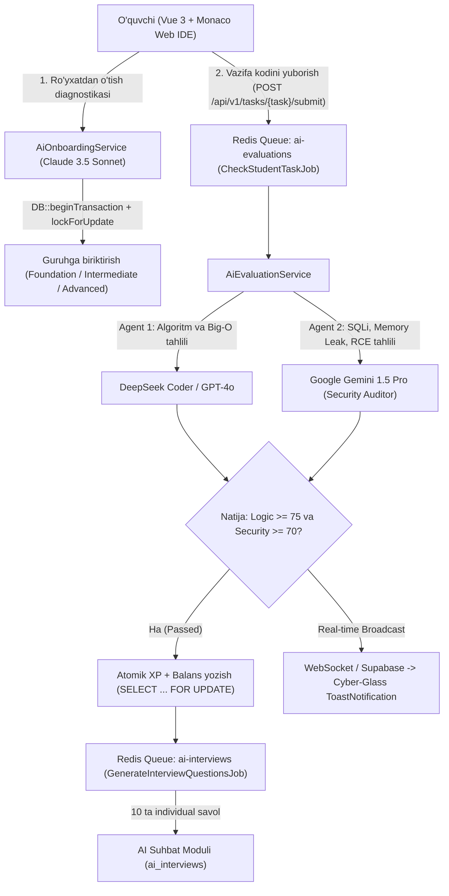

# 🚀 ITCloud Academy — AI-Powered Coding Bootcamp Platform


**ITCloud Academy** — 3 oylik intensiv dasturlash kurslarini to'liq sun'iy intellekt agentlari (Multi-Agent AI) yordamida boshqaruvchi, yuqori yuklamaga chidamli (**Highload**) va kiberxavfsizlik talablariga qat'iy javob beruvchi zamonaviy **AI-Powered Coding Bootcamp** ekotizimi.

Platforma kuniga guruhlar kesimida 40 nafargacha o'quvchini saralash (Onboarding), brauzerning o'zida kod yozish (**Monaco Web IDE**), kodni algoritmik va kiberxavfsizlik jihatidan tekshirish, shuningdek har bir muvaffaqiyatli vazifadan so'ng individual **10 ta texnik suhbat savolini** generatsiya qilish jarayonlarini avtomatlashtiradi.

---

## 🧠 1. Multi-Agent AI Arxitekturasi

Tizimda bitta umumiy AI modeli emas, balki har biri o'z vazifasiga ixtisoslashgan **3 bosqichli Multi-Agent AI orkestratori** (Repository va Service Layer pattern asosida) ishlaydi:



1. **Onboarding & Placement Agent (`AiOnboardingService` — Claude 3.5 Sonnet):**
   * O'quvchining boshlang'ich diagnostika javoblarini baholaydi (`0-100` ball).
   * Natijaga ko'ra o'quvchini `foundation`, `intermediate` yoki `advanced` darajadagi guruhga (maksimal sig'imi 40 ta) **Race Condition** xavfisiz (`lockForUpdate()`) biriktiradi.
2. **Code Logic & Complexity Agent (`AiEvaluationService` — DeepSeek / GPT-4o):**
   * Topshirilgan kodni test holatlari (`test_cases`), vaqt (`Time Complexity`) va xotira (`Space Complexity`) murakkabligi bo'yicha tekshiradi.
3. **Cyber Security Auditor Agent (`AiEvaluationService` — Google Gemini):**
   * Kodni xakerlik zaifliklariga tekshiradi: **SQL Injection**, **Memory Leak**, **Cheksiz sikllar (Unbounded Loops)**, **XSS** va **RCE**. Agar xavfsizlik bali `< 70` bo'lsa yoki zaiflik aniqlansa, vazifa darhol `security_rejected` maqomi bilan qaytariladi.

---

## 🛠️ 2. Texnologiyalar Steki (Tech Stack)

| Qatlam | Texnologiya | Vazifasi |
| :--- | :--- | :--- |
| **Backend** | PHP 8.3, Laravel 11 | Strict Typing (`declare(strict_types=1)`), Service & Repository Pattern |
| **Xavfsizlik va Auth** | Laravel Sanctum, Spatie Permission | Token autentifikatsiya, RBAC (`admin`, `ai-mentor`, `student`), AES-256 Model Casting |
| **Ma'lumotlar bazasi** | PostgreSQL 16 | Strict Relational, UUID kalitlar, JSONB, Pessimistic Locking (`SELECT ... FOR UPDATE`) |
| **Asinxron navbatlar** | Redis 7.4 + Linux Supervisor | `ai-evaluations` (8 worker) va `ai-interviews` (4 worker) fon navbatlari |
| **Frontend & Web IDE** | Vue 3 (Composition API), Pinia, Monaco Editor | Brauzer ichida Web IDE, reaktiv XP/Level/Wallet telemetriyasi |
| **UI Dizayn** | Tailwind CSS (**Cyber-Glass**) | `bg-white/5`, `backdrop-blur-md`, `border-cyan-500/30`, neon nurlanish effektlari |
| **Infratuzilma** | Docker & Docker Compose | Ubuntu 24.04 LTS uchun tayyor 4-konteynerli izolyatsiyalangan zanjir |

---

## 🔐 3. Kiberxavfsizlik va Moliyaviy/Gamifikatsiya Himoyasi

* **AES-256 Shifrlash (PII Encryption at Rest):**
  O'quvchilarning shaxsiy ma'lumotlari (`encrypted_phone`, `encrypted_passport_serial`, `encrypted_address`, `encrypted_github_token`) ma'lumotlar bazasida ochiq matnda emas, balki Laravel 11 `encrypted` casting yordamida **AES-256-CBC** algoritmi bilan shifrlangan holda saqlanadi.
* **PII Masking (`StudentResource`):**
  Pasport seriyasi faqat `admin` roliga ko'rinadi; `ai-mentor` roli o'quvchining shaxsiy ma'lumotlarini hech qachon ko'ra olmaydi.
* **Atomik Tranzaksiyalar va Race Condition Himoyasi (`StudentRepository`):**
  Barcha XP ballari, Level oshishi va hamyon balansi (`wallet_balance`) o'zgarishlari qat'iy `DB::beginTransaction()` va `lockForUpdate()` (`SELECT ... FOR UPDATE`) ichida bajariladi hamda har bir operatsiya `ledger_transactions` audit jadvalida `balance_before` va `balance_after` qiymatlari bilan muhrlanadi.
* **Qat'iy RBAC (`EnsureRoleHierarchyMiddleware`):**
  `admin`, `ai-mentor` va `student` rollari o'rtasida gorizontal (Cross-Tenant / IDOR) va vertikal ruxsatlar qat'iy chegaralangan.

---

## 📂 4. Loyiha Jildlar Strukturasi (Folder Structure)

```text
ITCloud-Academiy/
├── app/
│   ├── Events/
│   │   └── TaskEvaluatedEvent.php               # Real-time WebSocket broadcast (ShouldBroadcastNow)
│   ├── Http/
│   │   ├── Controllers/Api/V1/
│   │   │   ├── OnboardingController.php         # AI diagnostika va guruhga ajratish endpointi
│   │   │   └── TaskSubmissionController.php     # Kod yuborish va profil endpointi
│   │   ├── Middleware/
│   │   │   └── EnsureRoleHierarchyMiddleware.php # RBAC va IDOR himoya qatlami
│   │   └── Resources/
│   │       ├── StudentResource.php              # PII yashirilgan o'quvchi JSON transformeri
│   │       └── TaskSubmissionResource.php       # AI tekshiruv natijalari JSON transformeri
│   ├── Jobs/
│   │   ├── CheckStudentTaskJob.php              # Redis 'ai-evaluations' asinxron vazifa tekshiruvchisi
│   │   └── GenerateInterviewQuestionsJob.php    # Redis 'ai-interviews' 10 ta savol generatori
│   ├── Models/
│   │   ├── AiInterview.php
│   │   ├── Group.php
│   │   ├── LedgerTransaction.php
│   │   ├── Student.php                          # AES-256 encrypted casting modeli
│   │   ├── Task.php
│   │   └── TaskSubmission.php
│   ├── Providers/
│   │   └── RepositoryServiceProvider.php        # Interface -> Implementation DI bog'lamasi
│   ├── Repositories/
│   │   ├── Contracts/
│   │   │   └── StudentRepositoryInterface.php
│   │   └── Eloquent/
│   │       └── StudentRepository.php            # SELECT ... FOR UPDATE atomik operatsiyalar
│   └── Services/
│       └── AI/
│           ├── AiEvaluationService.php          # DeepSeek/GPT-4o + Gemini Security Auditor
│           └── AiOnboardingService.php          # Claude 3.5 Sonnet diagnostika servisi
├── config/
│   └── services.php                             # Anthropic, DeepSeek va Gemini API sozlamalari
├── database/
│   ├── migrations/
│   │   └── 2026_10_17_000001_create_bootcamp_core_tables.php
│   └── seeders/
│       └── RbacRolePermissionSeeder.php         # Admin, AI-Mentor va Student ruxsatlari
├── docker/
│   ├── nginx/
│   │   └── default.conf                         # Hardened Nginx konfiguratsiyasi
│   ├── php/
│   │   └── php.ini                              # PHP 8.3 OPcache + JIT konfiguratsiyasi
│   └── supervisor/
│       ├── laravel-worker.conf                  # Redis Queue Worker Supervisor sozlamasi
│       └── web-supervisord.conf                 # Nginx + PHP-FPM Supervisor sozlamasi
├── public/
│   └── index.php
├── resources/
│   └── js/
│       ├── components/
│       │   ├── ide/
│       │   │   └── TaskWorkspace.vue            # Monaco Editor Web IDE + Real-time listener
│       │   └── ui/
│       │       └── ToastNotification.vue        # Cyber-Glass Real-time xabarnoma komponenti
│       ├── stores/
│       │   └── useStudentStore.js               # Pinia Gamifikatsiya (XP, Level, Tier) do'koni
│       └── utils/
│           └── eventBus.js                      # Global Event Bus
├── routes/
│   └── api.php                                  # /api/v1/* marshrutlari
├── Dockerfile                                   # Multi-stage (frontend_builder, web, queue_worker)
├── docker-compose.yml                           # 4 ta konteyner zanjiri (db, cache, web, queue_worker)
├── composer.json
└── package.json
```

---

## 🐳 5. Docker Konteynerizatsiyasi (`itcloud_internal_net`)

Loyiha **Ubuntu 24.04 LTS** serverida 4 ta o'zaro bog'langan konteyner orqali yagona `itcloud_internal_net` bridge tarmog'ida ishlaydi:

1. **`db` (`postgres:16-alpine`):** Asosiy relyatsion baza. `pg_isready` healthcheck orqali tayyor bo'lmaguncha boshqa konteynerlarni kutish rejimida ushlab turadi.
2. **`cache` (`redis:7.4-alpine`):** Parol va AOF (`--appendonly yes`) bilan himoyalangan kesh hamda navbat brokeri.
3. **`web` (`Nginx + PHP 8.3-FPM`):** OPcache va JIT (`1255`) yoqilgan asosiy veb-server. Faqat `db` va `cache` konteynerlari `healthy` bo'lgach ishga tushadi.
4. **`queue_worker` (`Supervisor + PHP 8.3 CLI`):** Orqa fonda `ai-evaluations` (8 ta parallel protsess) va `ai-interviews` (4 ta parallel protsess) navbatlarini tinglovchi konteyner.

---

## 📡 6. Asosiy API Marshrutlari (`/api/v1`)

| Metod | URI | Nomlanishi | Middleware va Ruxsatlar |
| :--- | :--- | :--- | :--- |
| `GET` | `/api/v1/student/profile` | `api.v1.student.profile` | `auth:sanctum`, `EnsureRoleHierarchyMiddleware:student,admin` |
| `POST` | `/api/v1/onboarding/evaluate` | `api.v1.onboarding.evaluate` | `auth:sanctum`, `EnsureRoleHierarchyMiddleware:student,admin` |
| `POST` | `/api/v1/tasks/{task}/submit` | `api.v1.tasks.submit` | `auth:sanctum`, `EnsureRoleHierarchyMiddleware:student,admin` |
| `GET` | `/api/v1/mentor/health` | `api.v1.mentor.health` | `auth:sanctum`, `EnsureRoleHierarchyMiddleware:ai-mentor,admin` |

---

## ⚡ 7. O'rnatish va Ishga Tushirish (Ubuntu 24.04 LTS / Docker)

### 1-qadam: Repozitoriyani klonlash va `.env` sozlash
```bash
git clone https://github.com/itcloud-uz/ITCloud-Academiy.git
cd ITCloud-Academiy
cp .env.example .env
```

`.env` faylida AI kalitlarini kiriting:
```dotenv
ANTHROPIC_API_KEY=sk-ant-...
DEEPSEEK_API_KEY=sk-...
GEMINI_API_KEY=AIzaSy...
```

### 2-qadam: Docker konteynerlar zanjirini ishga tushirish
```bash
docker compose up -d --build
```

### 3-qadam: Migratsiyalar va RBAC rollarini yuklash
```bash
docker compose exec web composer install --no-dev --optimize-autoloader
docker compose exec web php artisan key:generate
docker compose exec web php artisan migrate --seed --force
```

### 4-qadam: Marshrutlar va Worker holatini tekshirish
```bash
docker compose exec web php artisan route:list
docker compose logs -f queue_worker
```

---

## 📄 Litsenziya

Ushbu loyiha **ITCloud Academy** intellektual mulki hisoblanadi. Barcha huquqlar himoyalangan.
